# RepoPulse

A data pipeline over public GitHub activity (GH Archive): raw event dumps → Spark bronze/silver → DuckDB warehouse with a dbt star schema → ML breakout prediction → natural-language-to-SQL agent.

> **Status: in progress.** Implemented components are distinguished from components verified through actual execution. Results below reflect measured runs, not assumed performance.

## Honest scope notes

- **The warehouse is DuckDB, a local file.** It is a stand-in for a cloud data warehouse such as BigQuery. No cloud service is used or claimed anywhere in this repository. I chose DuckDB because it needs no account or payment method, and it runs the same dbt workflow (staging, star schema, tests).
- DuckDB has no table partitions or clustering keys. `fact_events` is stored sorted by `event_date, event_type, repo_id`, so DuckDB's row-group min/max statistics can skip data on filters. The benchmark section reports whether that actually helps.
- Spark runs in **local mode** (one JVM). It is not a cluster.
- Airflow uses **LocalExecutor**. It orchestrates local pipeline tasks rather than a distributed execution cluster.

## Status

| Component | Status |
|---|---|
| Ingestion, bronze, silver (Spark local mode, quarantine, idempotent) | Verified |
| DuckDB load (transactional, idempotent) + dbt star schema, tests, window/session/retention models | Implemented |
| Data-quality gate | Verified: 7/7 checks passed |
| Airflow DAG (LocalExecutor, retries, backfill, DQ gate) | Implemented; DQ task test verified |
| ML: SparkML GBT vs SparkML logistic-regression baseline, batch scores in the warehouse | Verified: training and evaluation completed |
| NL-to-SQL agent + golden-set evaluation | Planned |
| FastAPI + MongoDB serving | Planned |

**Verification boundary:** The DQ task was successfully tested through Airflow. A full Airflow backfill has been attempted, but the available execution log shows the Bronze task entering retry and does not establish successful completion of the entire DAG.

## Architecture

Dashed nodes are planned and not built yet.

```mermaid
flowchart LR
    GH[GH Archive<br/>hourly JSON.gz] --> ING[ingest.py]
    ING --> RAW[(data/raw)]
    RAW --> BR[Bronze job<br/>PySpark local mode]
    BR --> BRZ[(Bronze Parquet<br/>date/hour)]
    BR --> QUA[(Quarantine Parquet)]
    BRZ --> SV[Silver job<br/>PySpark local mode]
    SV --> SLV[(Silver Parquet)]
    SLV --> DQ{DQ gate<br/>dq.py}
    DQ --> LOAD[load_warehouse.py<br/>transactional hour replace]
    LOAD --> DDB[(DuckDB file<br/>raw schema)]
    DDB --> DBT[dbt-duckdb: staging, star schema, tests]
    DBT --> GOLD[(gold schema)]
    GOLD --> FEAT[ML features in SQL]
    FEAT --> SPK[SparkML: GBT and<br/>logistic regression]
    SPK --> SCORES[(repo_breakout_scores)]
    GOLD --> AGENT[NL-to-SQL agent]
    SCORES --> API[FastAPI + MongoDB]
    AIR[Airflow, Docker, LocalExecutor] -.-> ING
    classDef planned stroke-dasharray: 5 5
    class AGENT,API planned
```



## Design notes

- **Bronze** parses a minimal, stable envelope and keeps the payload as a raw JSON string, so payload drift cannot break it. Unparseable lines go to quarantine with a reason code.
- **Silver** enforces an explicit schema, deduplicates on event id deterministically, and extracts typed per-event fields.
- **Idempotency:** Spark jobs delete the hour partitions they rewrite; the warehouse loader replaces the same hours inside one transaction, so a failed load changes nothing.
- **Data-quality gate** (before the warehouse load): every hour has enough rows, quarantine rate and silver/bronze loss are under limits, only expected event types, no null keys, unique event ids. `dbt test` is the second gate. Both fail the Airflow run and are never retried.
- **Warehouse:** raw table `raw.silver_events`; dbt builds `stg_silver_events` (view, dedupe), `dim_repo`, `dim_actor`, `dim_date`, `fact_events`, and three analytics models: hourly repo activity (window functions), actor sessions (30-minute gap, bots excluded) and retention cohorts (grain configurable; the earliest cohort is flagged `is_left_censored`).
- **dbt tests:** `unique`, `not_null`, `relationships`, `accepted_values`, plus three custom tests (`no_future_timestamps`, fact/staging reconciliation, merged-PR-must-be-closed).
- **SQL end-to-end test:** a synthetic-event test builds a warehouse, runs the real `dbt build`, and checks the ML feature SQL against a plain-Python reference. It runs offline in CI.

## Data-quality verification

The Airflow `dq_gate` task was tested using:

```powershell
./tasks.ps1 airflow tasks test repopulse_pipeline dq_gate 2024-06-01
```

<details>
<summary>Measured DQ results</summary>

**Execution window:** 2024-06-01, hours 00:00–05:00 (6 hourly partitions).

**Overall result: PASSED — 7/7 checks.**

| Check | Result | Measured detail |
|---|---|---|
| `silver_hours_present` | PASS | All 6 hours have at least 1,000 rows |
| `quarantine_rate` | PASS | 0 of 706,214 lines quarantined (0.000%, max 1.000%) |
| `silver_vs_bronze` | PASS | Bronze: 706,214; Silver: 706,214; loss: 0.000% (max 5.000%) |
| `silver_event_types` | PASS | All 5 expected event types found |
| `silver_required_not_null` | PASS | No nulls in event_id, event_type, created_at |
| `silver_key_null_rate` | PASS | repo_id and actor_id null rates: 0.000% |
| `silver_event_id_unique` | PASS | 706,214 distinct event IDs out of 706,214 |

The task exited with return code 0 and Airflow marked `dq_gate` as `SUCCESS`.

</details>

## ML

Predict whether a repo "breaks out": at least `breakout_threshold` stars in the next N hours, from features over the previous W hours.

- Walk-forward splits (train / valid / test cutoffs; features only use data before a cutoff, labels only after it).
- Main model: class-weighted SparkML gradient-boosted trees.
- Baseline: SparkML logistic regression.
- Sanity check: the heuristic "stars in the window".
- All three are scored by one metrics implementation; the threshold is chosen on the validation split and applied to the test split.
- Scores for the most recent window are written to `gold.repo_breakout_scores`.

### Model training configuration

| Parameter | Value |
|---|---:|
| Negative-to-positive downsampling ratio | 10:1 |
| GBT maximum tree count | 200 |
| GBT trees actually used | 48 |
| GBT maximum depth | 3 |
| GBT learning rate | 0.05 |
| Positive class weight | 10.85 |
| Logistic Regression maximum iterations | 100 |
| Logistic Regression regularization | 0.01 |
| Training time | 31.79 seconds |

### Measured model results

The following metrics are from the completed SparkML evaluation run.

| Metric | GBT | Logistic Regression | Heuristic |
|---|---:|---:|---:|
| AUC-ROC | 0.9864 | 0.9854 | 0.9789 |
| AUC-PR | 0.4067 | **0.6176** | 0.5354 |
| Precision | 0.4308 | **0.4529** | 0.4286 |
| Recall | 0.6548 | **0.7063** | 0.6905 |
| F1 | 0.5197 | **0.5519** | 0.5289 |
| Precision@Top-1% | 0.4568 | **0.4841** | 0.4645 |
| Lift@Top-1% | 62.52 | **66.25** | 63.58 |

**Current winner: Logistic Regression.**

Although GBT is the main experimental model, Logistic Regression achieved the best test AUC-PR (0.6176), precision, recall, F1 and top-1% ranking metrics.

This is an important result: the more complex tree-based model did not outperform the simpler linear baseline on this dataset.

### Test dataset details

| Metric | Value |
|---|---:|
| Test rows | 34,490 |
| Positive test examples | 252 |
| Test positive-class rate | 0.731% |
| Validation rows | 8,419 |
| Training rows | 33,943 |

At the top 1%, the evaluation considers 345 repositories.

Logistic Regression correctly identifies approximately 48.4% of these selected repositories as positive, compared with the overall test positive rate of approximately 0.73%.

### Statistical comparison

A paired bootstrap comparison of test AUC-PR was performed using 200 iterations.

| Model comparison | AUC-PR difference | 95% interval | Significant |
|---|---:|---:|---|
| GBT − Logistic Regression | -0.2109 | [-0.2459, -0.1746] | Yes |
| GBT − Heuristic | -0.1287 | [-0.1678, -0.0939] | Yes |
| Logistic Regression − Heuristic | +0.0823 | [+0.0615, +0.1027] | Yes |

The observed differences favor Logistic Regression over both alternatives in this evaluation run.

### GBT feature importance

The four most important features account for approximately 92% of the GBT model's total feature importance.

| Feature | Importance |
|---|---:|
| `stars_w` | 0.4063 |
| `pushes_w` | 0.2822 |
| `hours_since_first_seen` | 0.1233 |
| `unique_actors_w` | 0.1107 |
| `issue_events_w` | 0.0249 |
| `pr_events_w` | 0.0218 |
| `events_w` | 0.0078 |
| `forks_w` | 0.0067 |
| `merged_prs_w` | 0.0055 |
| `stars_recent_half` | 0.0049 |
| `star_accel` | 0.0031 |
| `active_hours_w` | 0.0024 |
| `stars_early_half` | 0.0004 |

These values represent relative feature importance, not causation or the direction of a feature's effect.

### ML limitations and next steps

- The positive class is rare, so evaluation should focus on AUC-PR, precision, recall and top-K performance rather than AUC-ROC alone.
- The training split contains only 211 positive examples before the holdout; 159 were used for fitting.
- The current result is an experimental benchmark, not proof of production-level generalization.
- The bootstrap uses 200 iterations; more iterations would help assess confidence interval stability.
- Further work includes testing multiple random seeds, tuning GBT parameters, experimenting with downsampling ratios, feature ablation and probability calibration.
- Additional time-based test periods are needed before treating Logistic Regression as a production-ready champion model.

> **Caveat:** The default horizon (N = 3 days) needs 216 hours of data. Runs on a few hours of data use small windows and produce noisy metrics from few positive examples. Treat them as a smoke test of the pipeline, not as a finding. BigQuery ML is not used.

## Quickstart (Windows PowerShell)

```powershell
./tasks.ps1 build
./tasks.ps1 run --start 2024-06-01 --end-hour 5
# Ingest + bronze + silver (Docker)

py -3.11 -m venv .venv
.\.venv\Scripts\python.exe -m pip install -e ".[dev,warehouse,dbt]"

./tasks.ps1 host-test
./tasks.ps1 dq --start 2024-06-01 --end-hour 5
./tasks.ps1 load --start 2024-06-01 --end-hour 5
./tasks.ps1 dbt build

./tasks.ps1 ml-features --feature-hours 2 --horizon-hours 2 --threshold 3
./tasks.ps1 ml-train
# Docker

./tasks.ps1 ml-eval
```

### Airflow commands

```powershell
# Test an individual task
./tasks.ps1 airflow tasks test repopulse_pipeline dq_gate 2024-06-01

# Backfill a date range
./tasks.ps1 airflow dags backfill -s 2024-06-01 -e 2024-06-01 repopulse_pipeline

# List DAG runs
./tasks.ps1 airflow dags list-runs -d repopulse_pipeline
```

## Results and current conclusions

1. The Spark ingestion and bronze/silver processing pipeline has been verified.
2. The data-quality gate passed all seven checks on the tested six-hour dataset, processing 706,214 events with zero quarantined records and zero bronze-to-silver loss.
3. The Airflow DQ task was successfully executed and marked `SUCCESS`.
4. SparkML successfully trained and evaluated both GBT and Logistic Regression models.
5. Logistic Regression currently outperforms GBT and the heuristic baseline on test AUC-PR.
6. The full Airflow backfill, complete warehouse/dbt execution and downstream serving components still need their respective end-to-end verification.

RepoPulse is being developed incrementally, with measured results and implementation boundaries documented rather than claiming a fully deployed production system.