# RepoPulse

A data pipeline over public GitHub activity (GH Archive): raw event dumps -> Spark bronze/silver
Parquet -> DuckDB warehouse with a dbt star schema -> ML breakout prediction -> natural-language-to-SQL
agent.

> **Status: in progress.** The table says what exists. "Implemented" means the code and tests exist;
> a row becomes "verified" only after I have run it end to end.

## Honest scope notes

- **The warehouse is DuckDB, a local file.** It is a stand-in for a cloud data warehouse such as
  BigQuery. No cloud service is used or claimed anywhere in this repository. I chose DuckDB because it
  needs no account or payment method, and it runs the same dbt workflow (staging, star schema, tests).
- DuckDB has no table partitions or clustering keys. `fact_events` is stored sorted by
  `event_date, event_type, repo_id`, so DuckDB's row-group min/max statistics can skip data on filters.
  The benchmark section reports whether that actually helps.
- Spark runs in **local mode** (one JVM). It is not a cluster.

## Status

| Component | Status |
|---|---|
| Ingestion, bronze, silver (Spark local mode, quarantine, idempotent) | verified |
| DuckDB load (transactional, idempotent) + dbt star schema, tests, window/session/retention models | implemented |
| Data-quality gate | implemented |
| Airflow DAG (LocalExecutor, retries, backfill, DQ gate) | implemented |
| ML: SparkML GBT vs SparkML logistic-regression baseline, batch scores in the warehouse | implemented |
| NL-to-SQL agent + golden-set evaluation | planned |
| FastAPI + MongoDB serving | planned |

## Architecture

Dashed nodes are planned and not built yet.

```mermaid
flowchart LR
    GH[GH Archive<br/>hourly JSON.gz] --> ING[ingest.py]
    ING --> RAW[(data/raw)]
    RAW --> BR[Bronze job<br/>PySpark local mode]
    BR --> BRZ[(Bronze Parquet<br/>date/hour)]
    BR --> QUA[(Quarantine Parquet)]
    BRZ --> SV[Silver job<br/>PySpark local mode]
    SV --> SLV[(Silver Parquet)]
    SLV --> DQ{DQ gate<br/>dq.py}
    DQ --> LOAD[load_warehouse.py<br/>transactional hour replace]
    LOAD --> DDB[(DuckDB file<br/>raw schema)]
    DDB --> DBT[dbt-duckdb: staging, star schema, tests]
    DBT --> GOLD[(gold schema)]
    GOLD --> FEAT[ML features in SQL]
    FEAT --> SPK[SparkML: GBT and<br/>logistic regression baseline]
    SPK --> SCORES[(repo_breakout_scores)]
    GOLD --> AGENT[NL-to-SQL agent]
    SCORES --> API[FastAPI + MongoDB]
    AIR[Airflow, Docker, LocalExecutor] -.-> ING
    classDef planned stroke-dasharray: 5 5
    class AGENT,API planned
```



## Design notes

- **Bronze** parses a minimal, stable envelope and keeps the payload as a raw JSON string, so payload
  drift cannot break it. Unparseable lines go to quarantine with a reason code.
- **Silver** enforces an explicit schema, deduplicates on event id deterministically, and extracts typed
  per-event fields.
- **Idempotency:** Spark jobs delete the hour partitions they rewrite; the warehouse loader replaces the
  same hours inside one transaction, so a failed load changes nothing.
- **Data-quality gate** (before the warehouse load): every hour has enough rows, quarantine rate and
  silver/bronze loss are under limits, only expected event types, no null keys, unique event ids.
  `dbt test` is the second gate. Both fail the Airflow run and are never retried.
- **Warehouse:** raw table `raw.silver_events`; dbt builds `stg_silver_events` (view, dedupe),
  `dim_repo`, `dim_actor`, `dim_date`, `fact_events`, and three analytics models: hourly repo activity
  (window functions), actor sessions (30-minute gap, bots excluded) and retention cohorts (grain
  configurable; the earliest cohort is flagged `is_left_censored`).
- **dbt tests:** `unique`, `not_null`, `relationships`, `accepted_values`, plus three custom tests
  (`no_future_timestamps`, fact/staging reconciliation, merged-PR-must-be-closed).
- **SQL end-to-end test:** a synthetic-event test builds a warehouse, runs the real `dbt build`, and
  checks the ML feature SQL against a plain-Python reference. It runs offline in CI.

## ML

Predict whether a repo "breaks out": at least `breakout_threshold` stars in the next N hours, from
features over the previous W hours. Walk-forward splits (train / valid / test cutoffs; features only use
data before a cutoff, labels only after it). Main model: class-weighted SparkML gradient-boosted trees.
Baseline: SparkML logistic regression. Sanity check: the heuristic "stars in the window". All three are
scored by one metrics implementation; the threshold is chosen on the validation split and applied to the
test split. Scores for the most recent window are written to `gold.repo_breakout_scores`.

> **Caveat:** the default horizon (N = 3 days) needs 216 hours of data. Runs on a few hours of data use
> small windows and produce noisy metrics from few positive examples. Treat them as a smoke test of the
> pipeline, not as a finding. BigQuery ML is not used.

## Quickstart (Windows PowerShell)

```powershell
./tasks.ps1 build
./tasks.ps1 run --start 2024-06-01 --end-hour 5          # ingest + bronze + silver (Docker)
py -3.11 -m venv .venv
.\.venv\Scripts\python.exe -m pip install -e ".[dev,warehouse,dbt]"
./tasks.ps1 host-test
./tasks.ps1 dq --start 2024-06-01 --end-hour 5
./tasks.ps1 load --start 2024-06-01 --end-hour 5
./tasks.ps1 dbt build
./tasks.ps1 ml-features --feature-hours 2 --horizon-hours 2 --threshold 3
./tasks.ps1 ml-train                                      # Docker
./tasks.ps1 ml-eval
```

## Results

To be filled in with measured numbers in the final phase. Nothing is claimed here until it is measured.