# RepoPulse

A data pipeline over public GitHub activity (GH Archive): raw event dumps -> Spark bronze/silver
Parquet -> DuckDB warehouse with a dbt star schema -> ML breakout prediction -> natural-language-to-SQL
agent.

> **Status: in progress.** The tables below separate what is *verified* (I ran it and checked the output)
> from what is *planned*. Numbers in this README are measured, not assumed.

## Honest scope notes

- **The warehouse is DuckDB, a local file.** It is a stand-in for a cloud data warehouse such as
  BigQuery. No cloud service is used or claimed anywhere in this repository. I chose DuckDB because it
  needs no account or payment method, and it runs the same dbt workflow (staging, star schema, tests).
- DuckDB has no table partitions or clustering keys. `fact_events` is stored sorted by
  `event_date, event_type, repo_id`, so DuckDB's row-group min/max statistics can skip data on filters.
  Whether that helps has not been benchmarked yet.
- Spark runs in **local mode** (one JVM). It is not a cluster.
- Airflow uses **LocalExecutor**: it orchestrates local tasks, not a distributed cluster.
- All measurements use one sample: **GH Archive 2024-06-01, hours 0-5 (six hours)**. That is far too
  little data for the default 3-day prediction horizon, so the ML results are a pipeline smoke test.

## Status

| Component | Status |
|---|---|
| Ingestion, bronze, silver (Spark local mode, quarantine, idempotent) | Verified |
| Data-quality gate | Verified: 7 of 7 checks passed |
| DuckDB load (transactional, idempotent) | Verified: unit-tested for idempotency and rollback; also run by the Airflow backfill |
| dbt star schema, tests, window / session / retention models | Verified: `dbt build` completed with all 41 steps passing (7 table models, 1 view, 33 tests) |
| Airflow DAG (LocalExecutor, retries, backfill, DQ gate) | Verified: a full backfill of 2024-06-01 completed with all seven tasks successful |
| ML: SparkML GBT vs SparkML logistic-regression baseline, batch scores in the warehouse | Verified: training and evaluation completed |
| CI (GitHub Actions) | Verified: green run on GitHub |
| NL-to-SQL agent + golden-set evaluation | Planned |
| FastAPI + MongoDB serving | Planned |

**Verification notes.** All verification used one sample: GH Archive 2024-06-01, hours 0-5. An earlier
Airflow backfill attempt showed the bronze task entering a retry; I did not diagnose the cause, and the
later full run completed with all seven tasks successful.

## Architecture

Dashed nodes are planned and not built yet.

```mermaid
flowchart LR
    GH[GH Archive<br/>hourly JSON.gz] --> ING[ingest.py]
    ING --> RAW[(data/raw)]
    RAW --> BR[Bronze job<br/>PySpark local mode]
    BR --> BRZ[(Bronze Parquet<br/>date/hour)]
    BR --> QUA[(Quarantine Parquet)]
    BRZ --> SV[Silver job<br/>PySpark local mode]
    SV --> SLV[(Silver Parquet)]
    SLV --> DQ{DQ gate<br/>dq.py}
    DQ --> LOAD[load_warehouse.py<br/>transactional hour replace]
    LOAD --> DDB[(DuckDB file<br/>raw schema)]
    DDB --> DBT[dbt-duckdb: staging, star schema, tests]
    DBT --> GOLD[(gold schema)]
    GOLD --> FEAT[ML features in SQL]
    FEAT --> SPK[SparkML: GBT and<br/>logistic regression baseline]
    SPK --> SCORES[(repo_breakout_scores)]
    GOLD --> AGENT[NL-to-SQL agent]
    SCORES --> API[FastAPI + MongoDB]
    AIR[Airflow, Docker, LocalExecutor] -.-> ING
    classDef planned stroke-dasharray: 5 5
    class AGENT,API planned
```



## Design notes

- **Bronze** parses a minimal, stable envelope and keeps the payload as a raw JSON string, so payload
  drift cannot break it. Unparseable lines go to quarantine with a reason code.
- **Silver** enforces an explicit schema, deduplicates on event id deterministically, and extracts typed
  per-event fields.
- **Idempotency:** Spark jobs delete the hour partitions they rewrite; the warehouse loader replaces the
  same hours inside one transaction, so a failed load changes nothing.
- **Warehouse:** raw table `raw.silver_events`; dbt builds `stg_silver_events` (view, dedupe),
  `dim_repo`, `dim_actor`, `dim_date`, `fact_events`, and three analytics models: hourly repo activity
  (window functions), actor sessions (30-minute gap, bots excluded) and retention cohorts (grain
  configurable; the earliest cohort is flagged `is_left_censored`).
- **dbt tests:** `unique`, `not_null`, `relationships`, `accepted_values`, plus three custom tests:
  `no_future_timestamps`, fact/staging reconciliation, and a merged-flag tolerance check.
- **SQL end-to-end test:** a synthetic-event test builds a warehouse, runs the real `dbt build`, and
  checks the ML feature SQL against a plain-Python reference. It runs offline.

## Data-quality gate

The gate runs between silver and the warehouse load and exits non-zero on failure, which fails the
Airflow run. `dbt test` is the second gate. Neither is retried, because a retry cannot fix bad data.

Tested with:

```powershell
./tasks.ps1 airflow tasks test repopulse_pipeline dq_gate 2024-06-01
```

**Measured result on the sample (six hours, 706,214 events): all 7 checks passed, 0 quarantined
records, 0 bronze-to-silver loss.**

| Check | What it verifies | Result |
|---|---|---|
| `silver_hours_present` | every requested hour has at least the minimum number of rows | pass |
| `quarantine_rate` | quarantined share of lines is under the limit | pass |
| `silver_vs_bronze` | silver is not suspiciously smaller than bronze | pass |
| `silver_event_types` | only the five expected event types | pass |
| `silver_required_not_null` | no nulls in event id, type, timestamp | pass |
| `silver_key_null_rate` | repo and actor ids are almost never null | pass |
| `silver_event_id_unique` | event ids are unique across the whole range | pass |

## Known data quirk

About 0.4% of `opened` pull-request events in the sample (141 of 36,234, GH Archive 2024-06-01) carry
`merged = true`. Silver keeps them as delivered. A dbt tolerance test fails the build only when the share
exceeds 1%, which would point to a parsing problem rather than a source quirk. I have not established
why the source contains these rows.

## ML

Predict whether a repo "breaks out": at least `breakout_threshold` stars in the next N hours, from
features over the previous W hours. This run used W = 2 h, N = 2 h, threshold = 3 stars.

- Walk-forward splits (train / valid / test cutoffs). Features only use data before a cutoff, labels
  only data after it.
- Main model: class-weighted SparkML gradient-boosted trees (GBT), with early stopping on a
  hash-selected 20% holdout of the training rows.
- Baseline: SparkML logistic regression on log-scaled features.
- Sanity check: the heuristic "stars in the window".
- All three are scored by one metrics implementation. The decision threshold is chosen on the
  validation split (best F1) and applied to the test split.
- Scores for the most recent window are written to `gold.repo_breakout_scores`.

### Reported configuration

| Parameter | Value |
|---|---|
| Negative-to-positive downsampling | 10 : 1 |
| GBT tree cap / trees actually used | 200 / 48 (early stopping) |
| GBT depth / learning rate | 3 / 0.05 |
| Positive class weight | 10.85 |
| Logistic regression | max 100 iterations, regularization 0.01 |
| Training time | 31.8 s and 49.5 s in two identical runs |

### Data sizes

| Item | Value |
|---|---|
| Training split before downsampling | 33,943 rows: 211 positives, 33,732 negatives |
| After 10:1 downsampling | 211 positives, 2,159 negatives |
| Used for fitting (after the 20% early-stopping holdout) | 159 positives, 1,725 negatives |
| Validation split | 8,419 rows, 42 positives |
| Test split | 34,490 rows, 252 positives (0.731%) |
| Score split (most recent window, no labels) | 30,853 rows |

### Results (test split)

| Metric | GBT | Logistic regression | Heuristic |
|---|---|---|---|
| AUC-ROC | 0.9864 | 0.9854 | 0.9789 |
| AUC-PR | 0.4067 | 0.6176 | 0.5354 |
| Precision | 0.4308 | 0.4529 | 0.4286 |
| Recall | 0.6548 | 0.7063 | 0.6905 |
| F1 | 0.5197 | 0.5519 | 0.5289 |
| Precision at top 1% (345 repos) | 0.4568 | 0.4841 | 0.4645 |
| Lift at top 1% | 62.52 | 66.25 | 63.58 |

**Current winner on this window: logistic regression.** It has the best AUC-PR, precision, recall, F1
and top-1% metrics. GBT has the highest AUC-ROC, by about 0.001, and the lowest AUC-PR. AUC-ROC is
saturated near 0.98-0.99 for all three, so it separates nothing; the positive class is rare, so AUC-PR
and top-K precision are the informative metrics. At the top 1%, 48.4% of the logistic regression's 345
selected repos are true positives, against a 0.73% base rate. The more complex tree model did not beat
the simple linear baseline.

### Statistical comparison

Paired bootstrap of test AUC-PR, 200 resamples, 95% intervals.

| Comparison | AUC-PR difference | 95% interval | Significant |
|---|---|---|---|
| GBT - logistic regression | -0.2109 | [-0.2459, -0.1746] | yes |
| GBT - heuristic | -0.1287 | [-0.1678, -0.0939] | yes |
| logistic regression - heuristic | +0.0823 | [+0.0615, +0.1027] | yes |

The bootstrap resamples repositories within one test window, so it understates the real uncertainty
(see limitations).

### GBT feature importance (reported configuration)

The top four features account for about 92% of the total.

| Feature | Importance |
|---|---|
| stars_w | 0.4063 |
| pushes_w | 0.2822 |
| hours_since_first_seen | 0.1233 |
| unique_actors_w | 0.1107 |
| issue_events_w | 0.0249 |
| pr_events_w | 0.0218 |
| events_w | 0.0078 |
| forks_w | 0.0067 |
| merged_prs_w | 0.0055 |
| stars_recent_half | 0.0049 |
| star_accel | 0.0031 |
| active_hours_w | 0.0024 |
| stars_early_half | 0.0004 |

Importance is relative and says nothing about causation or the direction of an effect.

### Fit diagnostics (overfitting and underfitting)

AUC-PR by split for the reported run. Train metrics cover all training rows, so they are mostly
in-sample; test is the later window.

| Model | Train AUC-PR | Test AUC-PR | Test minus train |
|---|---|---|---|
| GBT | 0.4708 | 0.4067 | -0.064 |
| Logistic regression | 0.5448 | 0.6176 | +0.073 |
| Heuristic (stars in window) | 0.4936 | 0.5354 | +0.042 |

- **There is no sign of overfitting.** The train-to-test gaps are small, and GBT's in-sample AUC-PR
  (0.4708) is below both logistic regression (0.5448) and the one-feature heuristic (0.4936). A model
  that cannot beat that one feature on rows it has seen is not memorizing noise. (In-sample AUC-ROC is
  about 0.99 for all three, which again separates nothing.)
- **The heuristic has no fitted parameters, yet scores 0.042 higher on test than on train.** That is
  window-to-window drift, so the positive gaps for logistic regression are mostly the window, not
  better generalization.
- **Whether GBT is underfit is not established.** Its in-sample ranking quality is lower than the
  baselines' at every setting tried (below), and early stopping ended training after only 15 to 48
  trees every time. That fits underfitting from early stopping, whose holdout contains only about 52
  positives. It also fits the features simply being better used by a linear model on a log scale. I have
  not separated these.

### Hyperparameter sweep (validation-based)

GBT settings were compared on the **validation** split. All rows below use 10:1 downsampling except D.
Logistic regression and the heuristic do not change between rows (validation AUC-PR 0.4600 and 0.3845).

| Setting | Depth | Learning rate | Trees used | Train AUC-PR | Validation AUC-PR | Test AUC-PR |
|---|---|---|---|---|---|---|
| A (reported) | 3 | 0.05 | 48 | 0.4708 | 0.4586 | 0.4067 |
| B | 4 | 0.10 | 19 | 0.4411 | 0.4081 | 0.4002 |
| C | 5 | 0.10 | 21 | 0.4365 | 0.3546 | 0.3710 |
| D (50:1 downsampling, depth 4) | 4 | 0.10 | 15 | not captured | not captured | not captured |

For D only the training output was captured (positive-class weight 53.54), so it is not compared.

- **Selection:** A has the best validation AUC-PR and is the reported configuration. The test metrics were
  printed alongside the validation metrics during the sweep, so this is not a blind selection.
- **Deeper trees did not help:** validation AUC-PR falls from 0.4586 (depth 3) to 0.4081 (depth 4) to
  0.3546 (depth 5), and train AUC-PR does not rise either, because early stopping used fewer trees.
- **On validation GBT (0.4586) and logistic regression (0.4600) are indistinguishable**, with only 42
  positives. Both beat the heuristic (0.3845).
- **Validation did not predict the test ranking.** From validation to test, GBT fell (0.4586 to 0.4067)
  while logistic regression (0.4600 to 0.6176) and the heuristic (0.3845 to 0.5354) both rose.
- **Hypothesis for the GBT drop, untested:** `hours_since_first_seen` is bounded by the cutoff minus the
  start of the data, so its range differs across the three cutoffs by construction (at most 2 h for
  train, 4 h for test, 6 h for the score window here). Trees split on thresholds learned in the narrow
  training range and can be sensitive to that shift; a log-scaled linear model degrades more gracefully.
  A feature ablation would test this.
- An earlier run (depth 4, 50 trees, no early stopping, no downsampling) scored GBT test AUC-PR 0.4976,
  higher than any run above. Several settings differed at once, so I do not attribute the difference to
  one of them.

### ML limitations and next steps

- The default horizon (N = 3 days) needs 216 hours of data. Six hours produce small windows and few
  positives. Treat these results as a smoke test of the pipeline, not as a finding.
- The validation split is a hash-selected 20% of repos at the same cutoff as training, so it is **not**
  a temporal holdout, and the decision threshold is chosen on it. The validation split has only 42
  positives.
- Walk-forward overlap: events in the train label window are also in the test feature window. No test
  label is used for training, but the two periods are not independent.
- The bootstrap resamples repositories, not time periods, so its intervals understate the uncertainty
  from having a single test window and a single random seed.
- "Logistic regression wins" holds for this window and this seed only.
- Planned: the `hours_since_first_seen` ablation, multiple seeds, more time windows, probability
  calibration, and a longer data window. BigQuery ML is not used.

## Measured pipeline performance

Spark local mode on a Windows laptop. Data lives on a Docker bind mount from the host drive, so I/O is
slower than native Linux. GH Archive 2024-06-01, not tuned.

| Job | Input | Time | Throughput |
|---|---|---|---|
| Bronze, 3 hours | 498,100 lines | 747 s | 667 lines/s |
| Bronze, 1 hour | 179,247 lines | 324 s | 554 lines/s |
| Silver, 3 hours | 370,725 rows | 172 s | 2,158 rows/s |
| Silver, 1 hour | 129,787 rows | 51 s | 2,521 rows/s |

Bronze is slow, and I have not yet measured where the time goes, so I make no claim about the cause.
Gzip files are not splittable, so each hourly file is read by a single task.

## Orchestration

`repopulse_pipeline` (daily): ingest -> bronze -> silver -> dq_gate -> load_warehouse -> dbt_run ->
dbt_test. Retries use exponential backoff; the DQ gate and `dbt test` fail the run and are never
retried. Catch-up is disabled, and past days are processed with `airflow dags backfill`. Every step is
idempotent by design. A full backfill of 2024-06-01 (hours 0-5) completed through all seven tasks.

```powershell
# Test one task
./tasks.ps1 airflow tasks test repopulse_pipeline dq_gate 2024-06-01

# Backfill a day
./tasks.ps1 airflow dags backfill -s 2024-06-01 -e 2024-06-01 repopulse_pipeline

# List runs
./tasks.ps1 airflow dags list-runs -d repopulse_pipeline
```

## Tests and CI

- `./tasks.ps1 host-test` runs the offline test suite on the host, including the synthetic SQL
  end-to-end test (35 tests).
- `./tasks.ps1 test` runs the Spark tests in Docker.
- GitHub Actions (`.github/workflows/ci.yml`) runs lint, the test suite, `dbt parse`, `dbt compile`
  and the Airflow DAG integrity tests. The latest run on the main branch is green.

## Quickstart (Windows PowerShell, Docker Desktop)

```powershell
./tasks.ps1 build
./tasks.ps1 run --start 2024-06-01 --end-hour 5            # ingest + bronze + silver (Docker)

py -3.11 -m venv .venv
.\.venv\Scripts\python.exe -m pip install -e ".[dev,warehouse,dbt]"

./tasks.ps1 host-test
./tasks.ps1 dq --start 2024-06-01 --end-hour 5
./tasks.ps1 load --start 2024-06-01 --end-hour 5
./tasks.ps1 dbt build

./tasks.ps1 ml-features --feature-hours 2 --horizon-hours 2 --threshold 3
./tasks.ps1 ml-train --neg-per-pos 10                       # Docker; defaults match setting A
./tasks.ps1 ml-eval
.\.venv\Scripts\python.exe -m repopulse.ml.valid_report     # validation-split metrics per model
```

## Conclusions so far

- The pipeline runs end to end on six hours of real data: Spark ingestion, bronze and silver, the
  data-quality gate, the DuckDB load, the dbt star schema with its tests, the Airflow DAG, and the ML
  step.
- The data-quality gate passed all seven checks on 706,214 events with zero quarantined records and zero
  bronze-to-silver loss.
- SparkML trained and evaluated both models. On this window logistic regression beats GBT and the
  heuristic on test AUC-PR. GBT does not overfit, and it did not improve with deeper trees or a higher
  learning rate. The result is a smoke test of the pipeline, not a production claim.
- Not yet done: a fix for the slow bronze job (I have not measured where the time goes), benchmarks of
  the sorted-table layout, a larger data window for the ML step, the `hours_since_first_seen` ablation,
  and the planned agent and serving components.